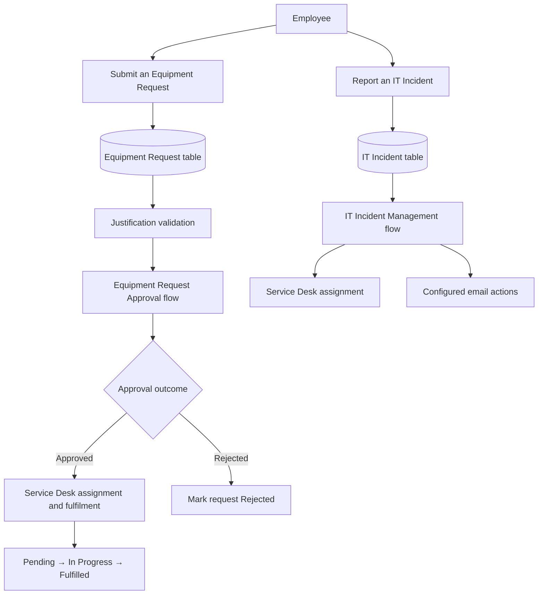

<div align="center">

# 🛠️ Employee IT Service Management

**A ServiceNow application for managing employee IT incidents and equipment requests through structured workflows, approvals, and fulfilment tracking.**


</div>

Employees need a clear way to report IT problems and request equipment. Support teams need a consistent process for reviewing, assigning, and resolving those requests.

This project brings those processes into one ServiceNow application.

## Why I built it

I wanted to build more than a set of forms. I wanted to understand how an internal service-management application fits together: data models, user-facing submission, validation, approvals, assignment, access control, and workflow automation.

The application currently focuses on two processes:

- **IT Incident Management** — capture incidents, validate required information, evaluate priority, and route work to IT support.
- **Equipment Request Management** — capture equipment needs and business justification, request approval, and track fulfilment.

## How it fits together



The diagram shows the configured application flow at a high level. Email actions have run in Flow Designer tests, but successful delivery to a recipient has not yet been independently confirmed.

## Application modules

| Module | Responsibility | Current implementation |
|---|---|---|
| IT Incident | Capture and route employee IT issues | Custom table, record producer, validation rule, Flow Designer workflow |
| Equipment Request | Capture and process equipment needs | Custom table, catalogue item, justification validation, approval and fulfilment workflow |
| Access control | Separate capabilities by user role | Roles created; Equipment Request ACLs configured; full coverage still in progress |

## The parts I've built

### 🎫 IT Incident Management

Employees can submit an IT incident through a record producer.

The IT Incident table stores the submitted issue and its handling information. A Business Rule prevents records from being submitted without a Short Description.

The **IT Incident Management** flow is triggered when a record is created. It runs configured email actions, checks whether the incident is high priority, and updates assignment to the Service Desk and a support agent.

**Implemented and checked:**

- Custom IT Incident table.
- Employee-facing Report an IT Incident record producer.
- Required Short Description validation.
- Flow Designer record-created trigger.
- High-priority decision branch and additional email action.
- Assignment update to Service Desk and a support agent.

### 💻 Equipment Request Management

Employees can request equipment and provide a business justification.

The **Equipment Request** table includes equipment type, employee, approval status, assignment group, fulfilment status, assigned support agent, and fulfilment notes.

A Business Rule prevents a request from being submitted without a business justification. The **Equipment Request Approval** flow handles approval and rejection outcomes.

When a request is approved, it is routed to the Service Desk and its fulfilment status is set to Pending. Support staff can then track progress.

**Implemented and checked:**

- Custom Equipment Request table.
- Employee-facing equipment request catalogue item.
- Equipment type choices and business justification field.
- Required Business Justification validation.
- Approval and rejection workflow paths.
- Approved request routing to the Service Desk.
- Fulfilment tracking: Pending, In Progress, Fulfilled, and Cancelled.
- Assigned Support Agent and Fulfilment Notes fields.

### 🔐 Roles and access control

The application has three application roles:

- `employee`
- `manager`
- `it_support_agent`

Equipment Request ACL records have been created for role-based access. This area is not considered complete yet: record-ownership conditions still need to be designed and tested, and application-specific IT Incident ACL coverage still needs to be added.

## Workflow details

### IT Incident

1. An employee submits an incident.
2. The Short Description Business Rule checks that the required description is present.
3. The record-created flow runs its configured email actions.
4. The flow evaluates whether the incident is high priority.
5. The flow updates the Assignment Group to Service Desk and assigns a support agent.

### Equipment Request

1. An employee submits an equipment request and business justification.
2. The Business Rule blocks the request if the justification is empty.
3. The record-created flow asks for approval.
4. If approved, the request is assigned to the Service Desk and set to Pending fulfilment.
5. If rejected, the Approval Status is set to Rejected.
6. Support staff update the assigned agent and fulfilment status as work progresses.

## Verification

I manually exercised the following behaviours in the ServiceNow instance:

| Check | Result |
|---|---|
| Submit an IT Incident without a Short Description | Blocked by Business Rule |
| Submit an Equipment Request without a Business Justification | Blocked by Business Rule |
| Approve an Equipment Request | Approval path completed |
| Reject an Equipment Request | Rejection path completed |
| Route an approved request to Service Desk | Confirmed |
| Progress fulfilment from Pending to In Progress to Fulfilled | Confirmed |
| Run the IT Incident flow test | Completed without a reported flow error |

The IT Incident flow test showed its trigger, email actions, priority condition, and record update completing. This confirms flow execution, **not end-to-end email delivery**.

## Tech stack

| Area | Technology |
|---|---|
| Platform | ServiceNow |
| Application development | ServiceNow Studio |
| Workflow automation | Flow Designer |
| User submissions | Service Catalog, Record Producers |
| Validation | Business Rules |
| Security | Roles, Access Control Lists (ACLs) |

## What's next

The checklist below reflects the current state of the project. Completed items are marked only where the configuration or behaviour has been checked. Remaining items will be updated as they are implemented and tested.

### Core application

- [x] Create the IT Incident table.
- [x] Create the Equipment Request table.
- [x] Build the Report an IT Incident record producer.
- [x] Build the Submit an Equipment Request catalogue item.
- [x] Add required-field validation for incident descriptions.
- [x] Add required-field validation for equipment justifications.
- [x] Build the IT Incident Management flow.
- [x] Build the Equipment Request Approval flow.
- [x] Implement approval and rejection paths.
- [x] Add equipment fulfilment status tracking.
- [ ] Review form layouts and user experience across roles.
- [ ] Add clear user feedback and notification handling for each workflow outcome.

### Security and access

- [x] Create employee, manager, and IT support agent roles.
- [x] Configure initial role-based ACLs for Equipment Request.
- [ ] Add application-specific ACLs for IT Incident.
- [ ] Implement record-ownership restrictions for employee access.
- [ ] Confirm manager access is limited to the intended records.
- [ ] Verify create, read, and update permissions for each role using test accounts.
- [ ] Review table and field-level access for sensitive information.

### Workflow and reliability

- [x] Test equipment approval and rejection.
- [x] Test an approved request through fulfilment.
- [x] Run the IT Incident flow test.
- [ ] Replace the temporary System Administrator approval test setup with the intended manager approval relationship.
- [ ] Verify email delivery end to end.
- [ ] Test additional priority and failure scenarios.
- [ ] Review duplicate submissions and unexpected workflow states.

### Documentation and portfolio

- [x] Create the GitHub project repository.
- [x] Add the initial project README.
- [ ] Add screenshots of the actual ServiceNow forms and workflows.
- [ ] Add a data model / table relationship diagram.
- [ ] Add a detailed architecture and workflow document.
- [ ] Add a security model document after ACL behaviour is verified.
- [ ] Add a test evidence document.
- [ ] Record a short project walkthrough.

## Repository structure

Documentation and screenshots will be added as the project develops.

```text
Employee-IT-Service-Management/
├── README.md
├── docs/
│   ├── architecture.md
│   ├── data-model.md
│   ├── workflows.md
│   └── security-model.md
├── screenshots/
├── diagrams/
└── testing/
```

## About

Built by [Zinhle Hlongwane](https://github.com/ZinhleHlongwane) as a personal ServiceNow development project.

The aim is to keep this repository an honest record of the application's development: what is implemented, what has been tested, and what still needs work.
